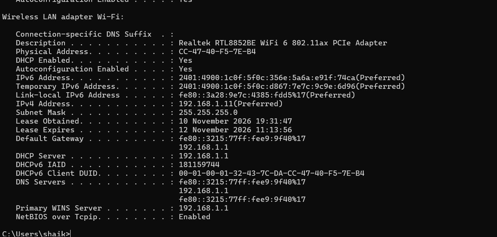
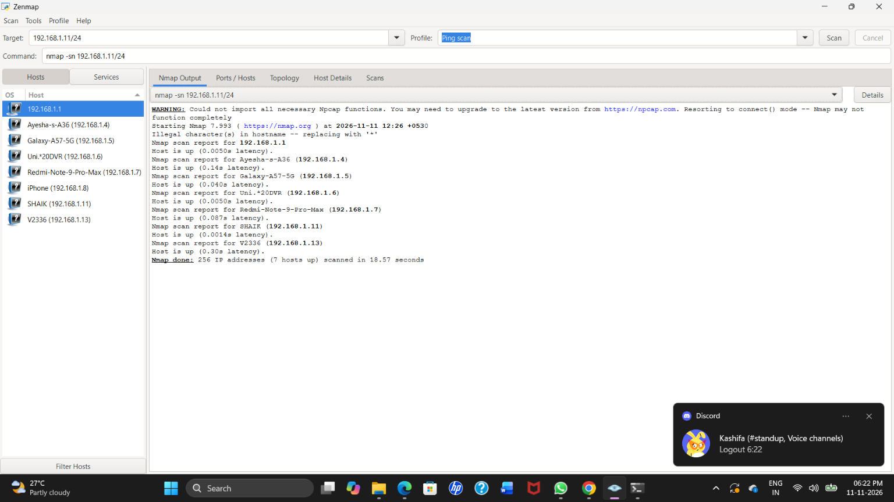
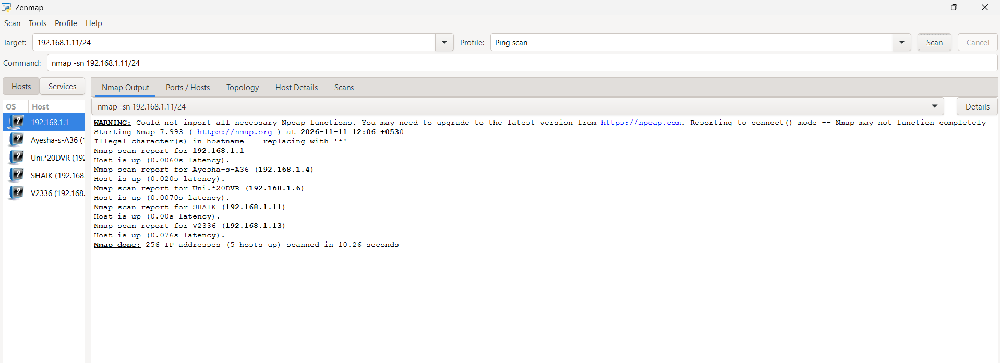
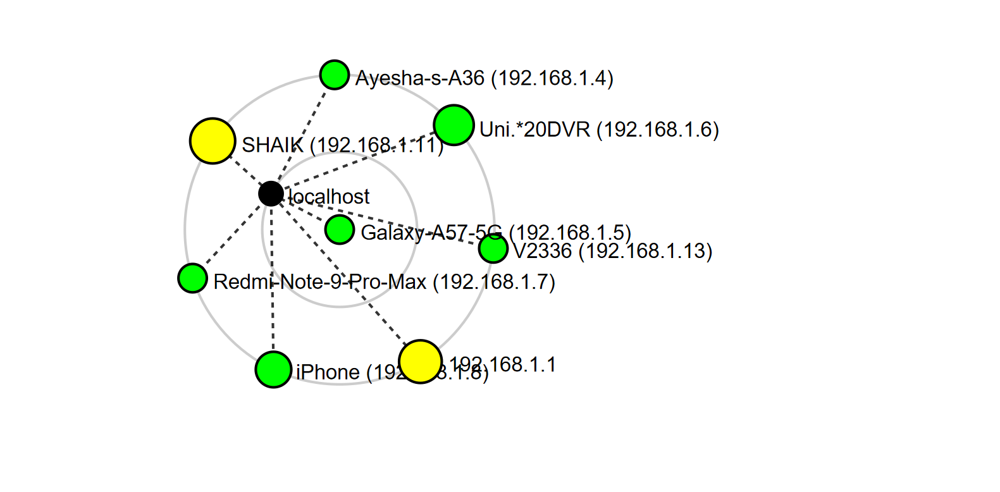
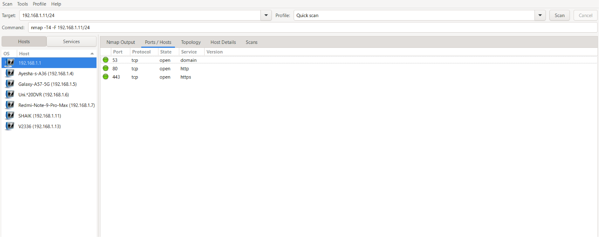
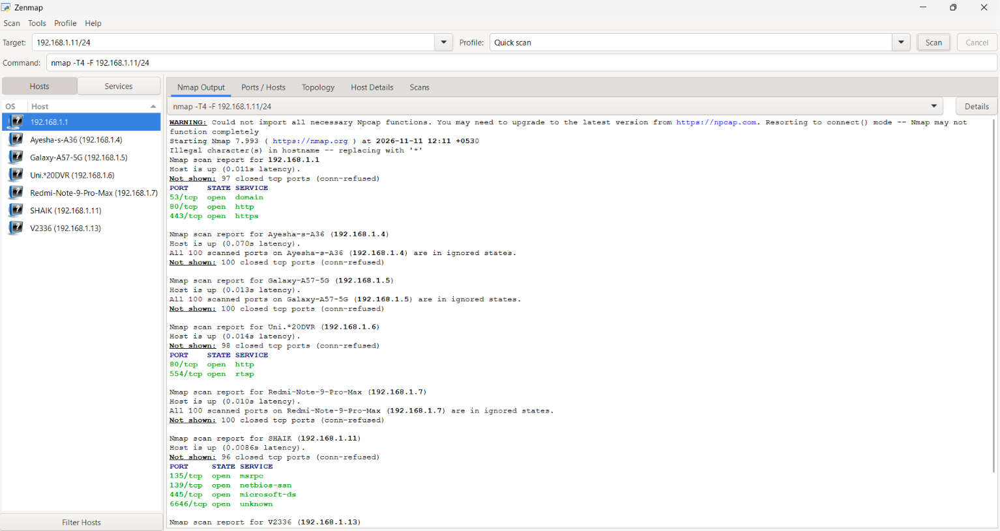
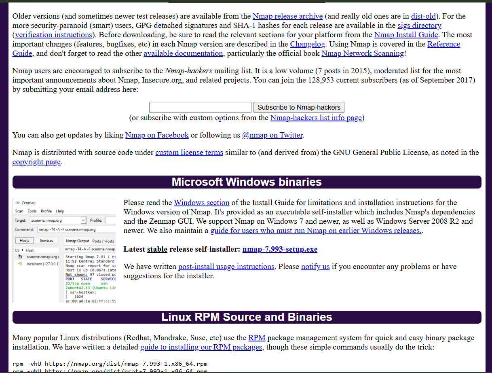

# W2-PM5 – Network Scanning with Zenmap

**Project Module:** Week 2 – Project Module 5  
**Program:** Networkwalks | Batch B084  
**Author:** Shaik Mahboob Mohiuddin  
**Tools:** Zenmap, Nmap, Windows CMD  
**Target Network:** `192.168.1.0/24`

---

## 1. Project Overview

This project focuses on network discovery and scanning using Zenmap, the graphical interface of Nmap. The main objective is to identify active devices, discover live hosts, collect IP address information, examine MAC address details, perform port scanning, and visualize the network topology.

This practical project was completed as part of the Cybersecurity Program at Networkwalks.

## 2. Objectives

- Identify the local IP address and subnet.
- Discover active hosts in the local network.
- Identify the IP addresses and hostnames of live devices.
- Examine MAC address information.
- Perform basic port and service scanning.
- Visualize the network topology.
- Understand the basics of network reconnaissance.

## 3. Tools and Technologies Used

| Tool | Purpose |
|---|---|
| Zenmap | Graphical network scanning |
| Nmap | Network discovery and port scanning |
| Windows CMD | IP and MAC address identification |
| Windows Wi-Fi | Local network connection |

## 4. Network Configuration

The following details were collected using the Windows `ipconfig /all` command.

| Parameter | Result |
|---|---|
| IPv4 Address | `192.168.1.11` |
| Subnet Mask | `255.255.255.0` |
| Network Subnet | `192.168.1.0/24` |
| Default Gateway | `192.168.1.1` |
| Local MAC Address | `CC-47-40-F5-7E-B4` |

## 5. Live Host Discovery

A Ping Scan was performed using Zenmap to identify active devices in the subnet.

**Command:**
```bash
nmap -sn 192.168.1.0/24
```

**Scan Results:**

- Total IP addresses scanned: 256
- Initial live hosts detected: 7
- Scan type: Ping Scan

### List of Live Hosts

| No. | Hostname | IP Address |
|---|---|---|
| 1 | Router | `192.168.1.1` |
| 2 | Ayesha-s-A36 | `192.168.1.4` |
| 3 | Galaxy-A57-5G | `192.168.1.5` |
| 4 | Uni.*20DVR | `192.168.1.6` |
| 5 | Redmi-Note-9-Pro-Max | `192.168.1.7` |
| 6 | SHAIK | `192.168.1.11` |
| 7 | V2336 | `192.168.1.13` |

A later repeat scan detected 5 live hosts. Network device availability may change between scans.

## 6. MAC Address Identification

The Windows `ipconfig /all` output identified the physical address of the local Wi-Fi adapter.

**Confirmed MAC Address:**

`192.168.1.11 → CC-47-40-F5-7E-B4`

MAC addresses for the other devices were not visible in the supplied scan evidence and have not been assumed.

## 7. Port Scanning and Service Identification

Zenmap Quick Scan was used to identify open TCP ports on selected devices.

| Host IP | Open Ports | Services |
|---|---|---|
| `192.168.1.1` | 53, 80, 443 | DNS, HTTP, HTTPS |
| `192.168.1.6` | 80, 554 | HTTP, RTSP |
| `192.168.1.11` | 135, 139, 445, 6646 | MSRPC, NetBIOS, Microsoft-DS, Unknown |

An open port does not automatically indicate a security vulnerability. Further investigation is required to determine potential risks.

## 8. Network Topology

The Zenmap topology feature was used to visualize the discovered devices and their network relationships.

The topology screenshot includes the router, local computer, and connected devices. It also shows an iPhone at `192.168.1.8`, which was not listed in the initial seven-host scan.

## 9. Project Screenshots and Evidence

### 9.1 Windows IP Configuration



### 9.2 Initial Ping Scan – 7 Live Hosts



### 9.3 Repeat Ping Scan – 5 Live Hosts



### 9.4 Network Topology Diagram



### 9.5 Ports and Hosts



### 9.6 Quick Scan Results



### 9.7 Zenmap Application



## 10. Project Report

The complete project documentation is available below.

📄 **[Click Here to View / Download the Project Report (PDF)](./W2-PM5_REPORT.pdf)**

## 11. Security Recommendations

- Use strong passwords for router and DVR administration.
- Disable unnecessary network services.
- Restrict unauthorized access to DVR and RTSP services.
- Keep network devices and operating systems updated.
- Configure Windows Firewall properly.
- Use WPA2 or WPA3 Wi-Fi security.
- Regularly monitor connected devices.
- Maintain an updated network inventory.

## 12. Conclusion

This project provided practical experience in network discovery, host identification, and basic port scanning using Zenmap and Nmap.

The initial scan successfully identified seven live hosts in the local subnet `192.168.1.0/24`. The project also demonstrated IP address identification, MAC address examination, TCP port discovery, and network topology visualization.

This exercise improved my understanding of network reconnaissance and basic network security assessment.

## 13. Limitations

- MAC addresses of all other discovered devices were not available in the supplied scan output.
- The initial scan detected seven hosts, while the repeat scan detected five.
- The topology screenshot represents a different discovery snapshot.
- An exported topology PDF was not included in the supplied evidence.

## 14. Disclaimer

This project was conducted for educational purposes on an authorized local network. Network scanning should only be performed on systems and networks for which permission has been granted.

---

**Project:** W2-PM5 – Network Scanning with Zenmap  
**Created by:** Shaik Mahboob Mohiuddin  
**Program:** Networkwalks | Batch B084
